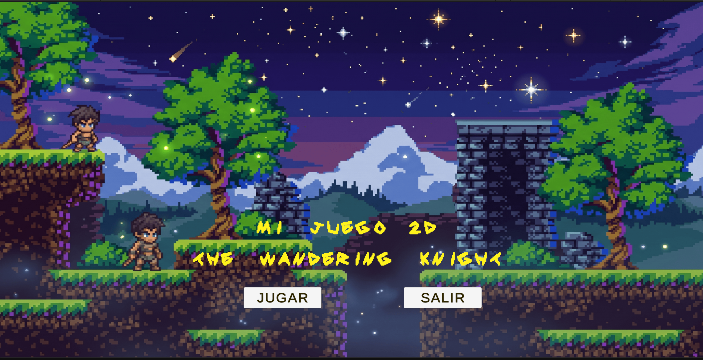
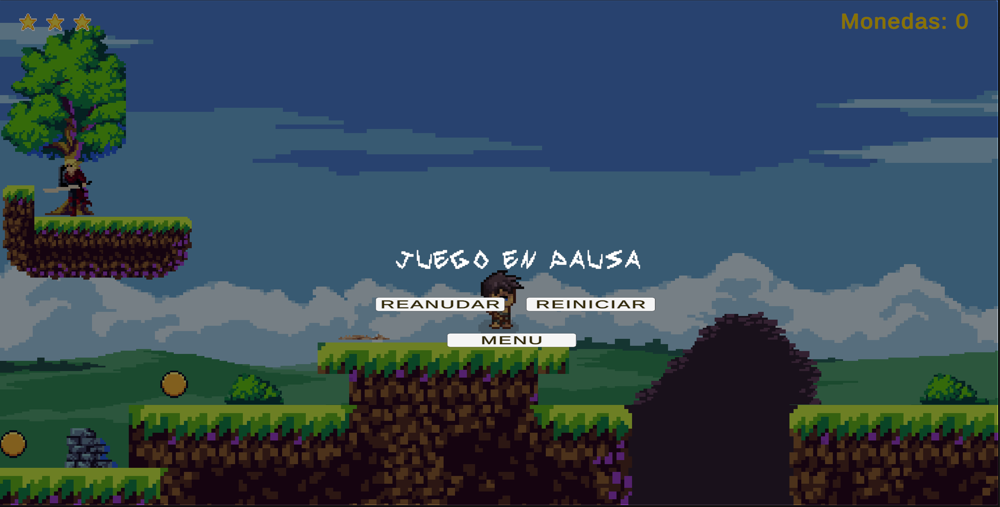
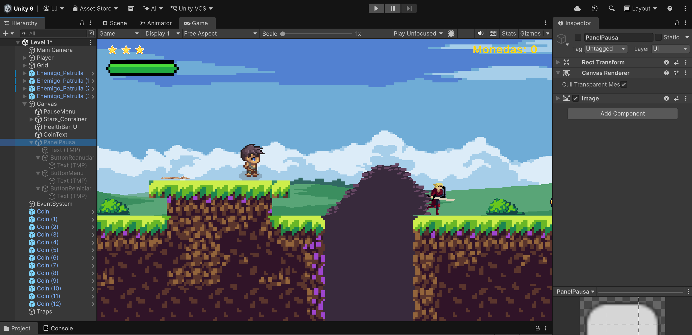
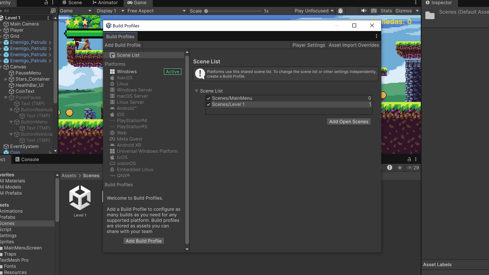

# Taller 8: Sistema de Menús, Pausa In-Game y Navegación entre Escenas
# The Wandering Knight - 2D Platformer

> **Aviso Académico:** Este proyecto ha sido desarrollado exclusivamente con fines formativos y académicos dentro del curso de Diseño y Desarrollo de Videojuegos 2D. Todos los recursos empleados se utilizan con propósito educativo.

### Descripción General
Se implementó la arquitectura completa de navegación y control de estados de juego para un título comercial en 2D: la pantalla de inicio (*MainMenu* - *The Wandering Knight*), la transición entre niveles mediante `SceneManager.LoadScene`, el sistema de congelamiento de físicas en tiempo real (`Time.timeScale = 0f`) y el registro formal de la lista de escenas en *Build Profiles / Build Settings*.

---

### Características Implementadas

1. **Pantalla de Inicio (`MainMenu`):**
   - Escena dedicada con fondo temático nocturno pixel art, adaptada a resolución 16:9 (`1920x1080`) mediante `Canvas Scaler`.
   - Título estilizado con TextMeshPro (*Redden SDF*) aplicando gradiente vertical dorado, contorno (*outline*) y sombra.
   - Script `MainMenu.cs` con métodos públicos `Jugar()` para cargar `Level 1` y `Salir()` con `Application.Quit()`.

2. **Menú de Pausa In-Game (`PanelPausa`):**
   - Panel semitransparente dentro del Canvas de la escena principal, desactivado por defecto en el arranque.
   - Script `PauseMenu.cs` que detecta las teclas `Escape` o `P` para alternar el estado de pausa.
   - Congelamiento instantáneo de físicas, corrutinas y animaciones (`Time.timeScale = 0f`), y restauración fluida (`Time.timeScale = 1f`).
   - Botones interactivos para **Reanudar**, **Reiniciar** nivel actual e **Ir al Menú Principal**.

3. **Configuración de Escenas en Unity:**
   - Registro en *Build Profiles*:
     - **Índice 0:** `Scenes/MainMenu`
     - **Índice 1:** `Scenes/Level 1`

---

### Scripts Desarrollados
- `Assets/Script/MainMenu.cs`: Control de flujo de inicio y salida.
- `Assets/Script/PauseMenu.cs`: Gestión del tiempo (`Time.timeScale`) y visibilidad del panel de pausa.

---

### Evidencias Gráficas y Entregables

#### 1. Pantalla del Menú Principal (MainMenu)


#### 2. Menú de Pausa Activo In-Game


#### 3. Panel de Pausa Desactivado (Inicio de Nivel)


#### 4. Registro en Build Profiles


---

### Video Demostrativo
- **Enlace al video (Google Drive):** [Ver Video Demostrativo - Taller N° 8](https://drive.google.com/file/d/1moYm_rk6KDgcP9P3Zu60gkEpEE2hg3Qi/view?usp=sharing)


## 🛠️ Cómo Abrir el Proyecto en Unity

1. Clona este repositorio o descarga el archivo ZIP:
   ```bash
   git clone [https://github.com/luisAristeguieta/videoJuego8.git](https://github.com/luisAristeguieta/videoJuego8.git)

2. Abre Unity Hub.
3. Haz clic en Add > Add project from disk.
4. Selecciona la carpeta raíz del repositorio clonado.
5. Abre el proyecto con Unity 6 (o versión compatible).
6. Dirígete a Assets/Scenes/ y abre la escena principal Level 1.unity.
7. Presiona Play para interactuar con el nivel y probar la recolección de monedas.